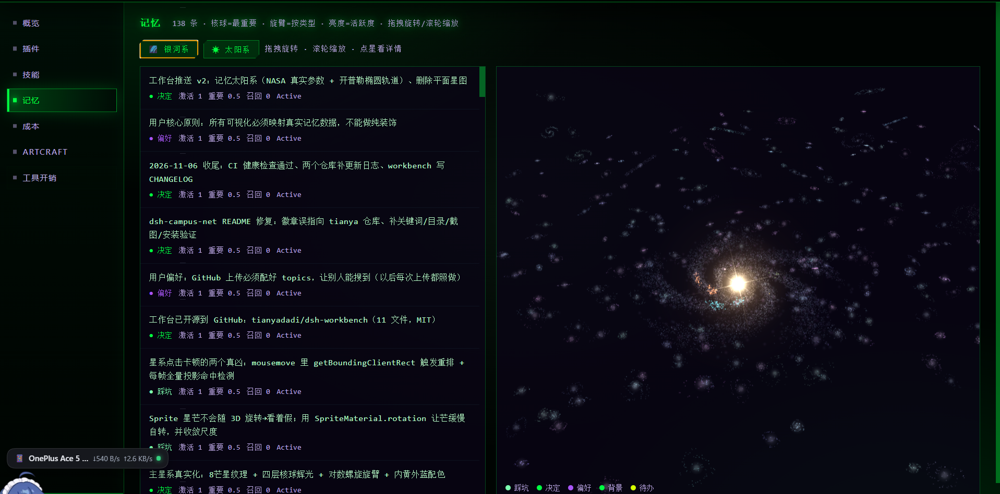
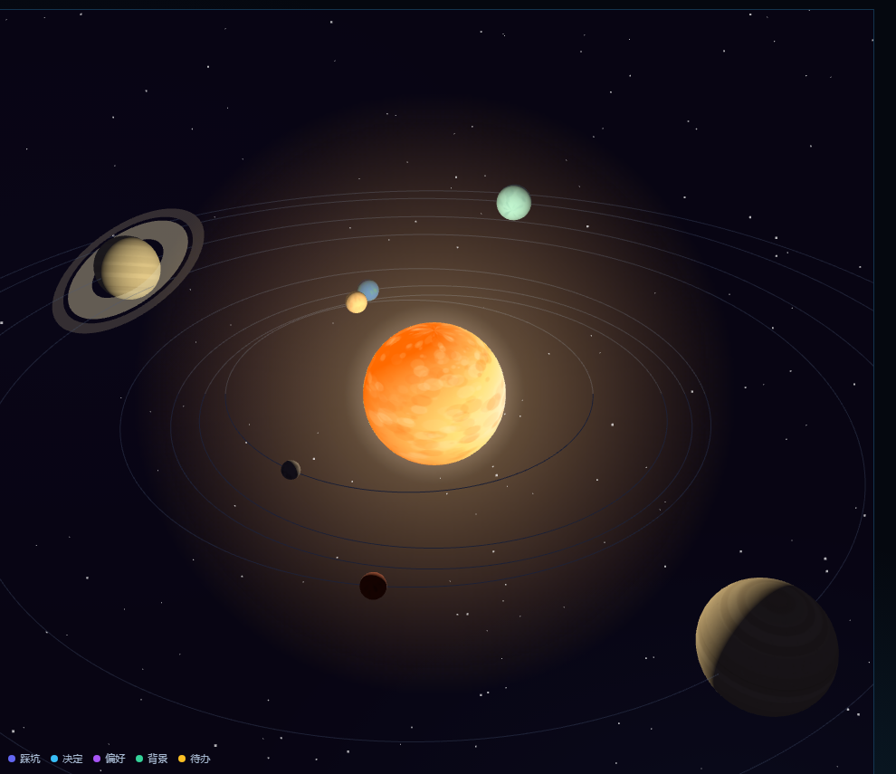
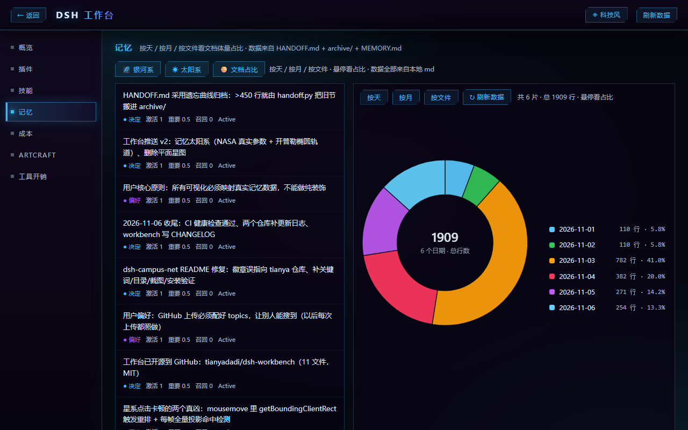
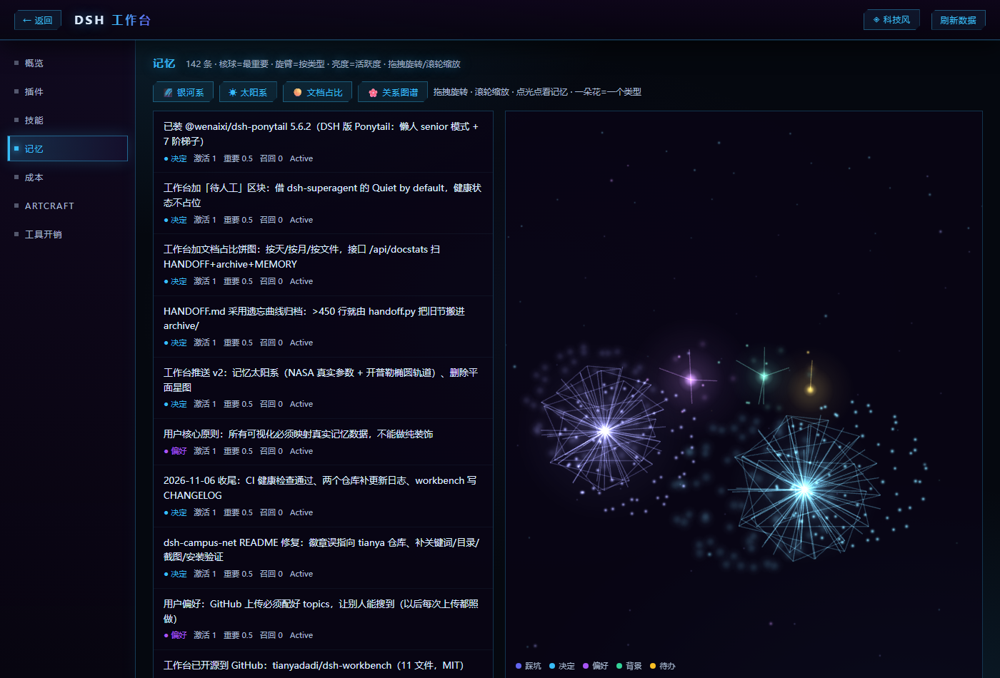
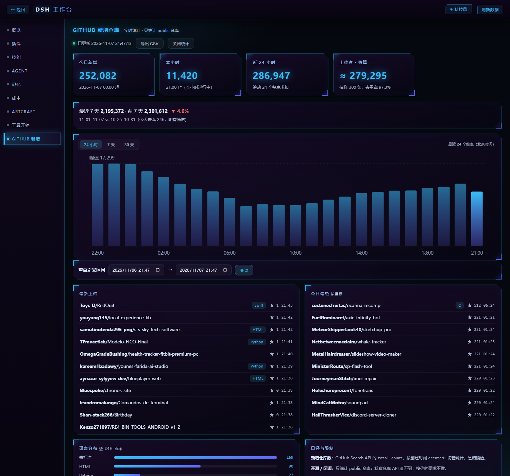
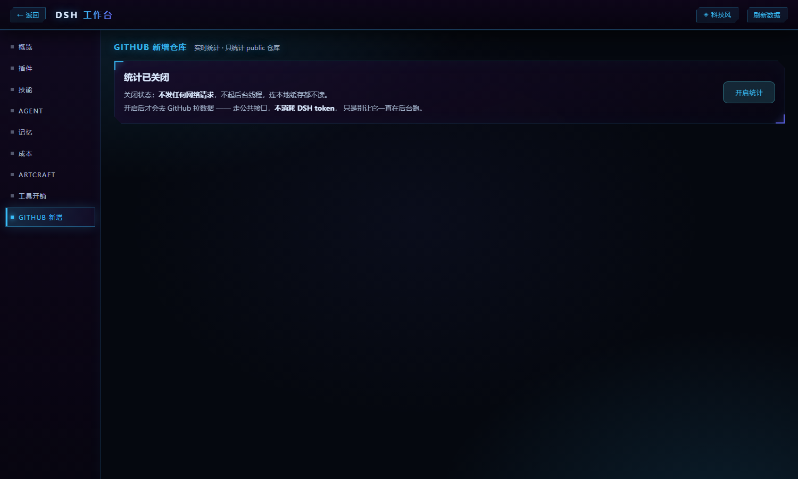

# DSH 工作台（dsh-workbench）

> DeepSeek Harness 的本地可视化面板 —— **零依赖、零 token**（只有 GitHub 面板会联网）。

一个单文件 Python 服务 + 单页前端，把 DSH 的插件、技能、记忆、成本、ArtCraft 应用全部可视化出来。
打开就看不消耗任何 token，因为它只读本地文件，从不调用模型。

| 记忆银河系 | 记忆太阳系 | 文档占比饼图 | 关系图谱 |
|---|---|---|---|
|  |  |  |  |

## 特性

- **9 个面板**：概览 / 插件 / 技能 / Agent / 记忆 / 成本 / ArtCraft / 工具开销 / GitHub 新增
- **记忆银河系**：把记忆库映射成 3D 螺旋星系（three.js + 自定义着色器）
  - 核球 = 重要度最高的记忆，旋臂 = 按类型分组，亮度 = 活跃度
  - 480 个自转小星系、星云气体层、8 芒星核球、主盘与外围差速旋转
- **记忆太阳系**：太阳 = `MEMORY.md` 文档总览 + 最重要 5 条记忆，8 颗行星 = 按类型分组的记忆
  - 真实参数：半径（地球=1）、自转周期、公转周期、轴倾角、轨道偏心率，全部取自 NASA 数据
  - 椭圆轨道 + 开普勒方程（近日点快、远日点慢），土星带环
  - 点行星看该类记忆，点太阳看记忆文档
- **文档占比饼图**：按天 / 按月 / 按文件看文档体量（行数）占比
  - 数据源：`HANDOFF.md` + `archive/*.md` + `MEMORY.md`，全部本地扫描
  - 每个 `##` 节按标题里的日期归到天；没有日期的归到文件修改日
  - 悬停看单片占比，点图例看明细，`↻ 刷新数据` 重扫（不用重启服务）
  - 直达链接：`http://127.0.0.1:8799/?panel=memory&view=pie&pie=day`
- **记忆编年环**：一圈一天，由内向外看记忆怎么长出来的
  - 一个光点 = 一条记忆（颜色 = 类型，大小 = importance）
  - 细线 = 两条记忆共享同一个 tag（跨天也连）
  - 中心显示总条数与天数；拖拽旋转 / 滚轮缩放 / 点击看详情
- **关系图谱**：每类记忆一朵「发光星云花」，线条是真实关系不是装饰
  - 一朵花 = 一个类型；花心 = 该类聚合点；一个光点 = 一条记忆（越重要越靠里）
  - 放射线 = 记忆与类心的从属关系；网格线 = Fibonacci 球面上相邻的节点
  - 外围星尘 = 每条记忆再投影一个「长期层」点，亮度 = activation
  - 拖拽旋转 / 滚轮缩放 / 点光点看记忆；颜色跟着主题的 `--kind-*` 走
- **待人工提醒**：概览顶部只列「需要你处理」的事，每条带下一步动作
  - 一切正常时只有一行灰字，不占地方（原则抄自 dsh-superagent 的 "Quiet by default"）
  - 检查 7 项：配置路径是否存在、插件是否掉目录、HANDOFF.md 是否超行数、记忆库是否可读
  - 核心插件（dsh-base / dsh-web-app）自带在 DSH 里，不算"目录缺失"，不误报
- **插件开关**：从 `profile.bundles` 摘掉/加回，自动备份
- **插件参数**：可视化表单直接改 JSON 配置（滑块、开关）
- **插件卸载**：带确认警告窗
- **ArtCraft 开关**：控制 14 个成员应用是否可用
- **4 套主题**：科技风 / 赛博朋克 / 黑客 / 清爽风，一键切换，入口按钮联动
- **零第三方依赖**：只用 Python 标准库；three.js 已本地化到 `lib/`

## 安装

```bash
git clone https://github.com/tianyadadi/dsh-workbench.git
cd dsh-workbench
```

需要 Python 3.8+，不需要 pip install 任何东西。

## 配置

复制 `config.example.json` 为 `config.json`，把路径改成你自己机器上的：

```json
{
  "modules_dir": "C:/Users/你的用户名/.dsh/node_modules",
  "memory_dir": "C:/Users/你的用户名/.dsh/memory",
  "artcraft_dir": "C:/Users/你的用户名/.dsh/artcraft",
  "runtime_dir": "",
  "workarea_dir": "C:/Users/你的用户名/workarea"
}
```

| 字段 | 说明 | 不填会怎样 |
|---|---|---|
| `modules_dir` | DSH 插件的 node_modules 目录 | 插件面板空 |
| `memory_dir` | 记忆库目录（含 `index.sqlite`） | 记忆面板空 |
| `artcraft_dir` | ArtCraft 安装目录 | 显示未安装 |
| `runtime_dir` | DSH 运行时目录（只读版本号） | 显示 `?` |
| `workarea_dir` | 交接文档目录（含 `HANDOFF.md`） | 饼图里没有交接文档，只剩 `MEMORY.md` |
| `dsh_home` | 默认 `~/.dsh` | 用默认值 |

也可用环境变量：`DSH_MODULES_DIR` / `DSH_MEMORY_DIR` / `DSH_ARTCRAFT_DIR` / `DSH_RUNTIME_DIR` / `DSH_WORKAREA_DIR`。

## 启动

**Windows**：双击 `start.cmd`

**Linux / macOS**：

```bash
chmod +x start.sh
./start.sh          # 默认 8799 端口
./start.sh 9000     # 指定端口
```

或者直接：

```bash
python server.py --port 8799
```

打开 http://127.0.0.1:8799

## 插件参数（自动发现）

点插件行的 **⚙** 就能改配置。**不需要事先配置**，规则如下：

1. **找配置文件**（按顺序）：
   - 插件目录内的 `*.config.json` / `config.json` / `settings.json`
   - `~/.dsh/<名字>.json`、`~/.dsh/.<名字>.json`、`~/.dsh/.<名字>-config.json` 等
2. **推断表单**：读 JSON 后按值类型自动生成控件
   - `true/false` → 开关
   - 数字 → 滑块（0~1 用 0.05 步进，端口这类大数用 500）
   - 字符串 → 文本框
   - 嵌套对象 → 展开成 `a.b` 两级（比如 `bins.photocraft`、`control.filmcraft`）
3. **保存**：按路径写回嵌套结构，写前校验 JSON 并备份 `.bak-时间戳`

> 想给某个插件定制中文标签和字段顺序，在 `server.py` 的 `PLUGIN_FIELDS` 里加一张表即可（手工表优先于自动推断）。

## 面板说明

| 面板 | 内容 |
|---|---|
| 概览 | 待人工提醒 + 插件数、技能数、记忆数、工具定义 token、会话花费、磁盘占用 |
| 插件 | 包名、用途、工具数、体积、启用状态、开关、参数、卸载 |
| 技能 | 技能目录、来源、描述 |
| Agent | `~/.dsh/agents/` 下的 Agent 定义：启用开关、技能绑定、重载提示 |
| 记忆 | 列表 + 五种视图：3D 银河系 / 太阳系 / 文档占比饼图 / 关系图谱 / 编年环 |
| 成本 | 工具定义 token 明细、开销排行 |
| ArtCraft | 14 个成员应用的安装状态与启用开关 |
| 工具开销 | 每个工具的定义 token 估算 |
| GitHub 新增 | 全站 public 仓库新增数：24 小时 / 7 天 / 30 天曲线 + 今日/本小时/近 24h + 上传者估算 + 最新上传流（唯一联网面板） |

## GitHub 新增仓库面板

工作台里唯一会联网的面板，只在打开它时才发请求，关掉页面就不再发。



### 开关（默认关闭）

面板顶部有**开关**，默认关闭：

- **关闭时**：不发任何网络请求、不起后台线程、连本地缓存都不读。前端也不轮询，退出面板即彻底静默
- **开启后**：才开始抓数据，状态存进 `config.json` 的 `github_enabled`，重启后保持
- 这个面板抓的是 GitHub 公共接口，**不消耗 DSH token**（token 是模型计量）；开关管的是"别让它在后台一直跑"



- **新增仓库数**：GitHub Search API 的 `total_count`，按 `created:` 切窗（24 个本地整点 + 30 个本地日），**精确值**
- **上传者数**：GitHub 没有按人去重的接口，抽样 300 条按 `owner` 去重、按去重率外推，**估算值**
- **开源 / 闭源**：只统计 public 仓库；私有仓库 API 查不到，不做
- **实时性**：GitHub 搜索索引有 5–15 分钟延迟，所以是「分钟级实时」，不是秒级
- **数据源**：本机直连 `api.github.com` 会被 TCP 重置（2026-11-07 实测），默认经 `gh-proxy.com` 转发

首次打开要拉 54 个历史窗口（约 2–3 分钟，进度条实时显示），之后每小时只增量抓 1–2 个窗口。
结果缓存在 `_github_cache.json`（已 gitignore），删掉即可重建。

**缓存怎么更新、会不会越积越多：**

- 同一个窗口重抓 = **覆盖**（不新增条目）
- 跳过旧的窗口 key，保留期 45 天日 / 72 小时（`_gh_prune()`，每次打开面板时顺手剪）
- 剪完稳定在 ~1400 个条目、200KB 上下，不会无限长

配置项（`config.json`，都可选）：

| 键 | 默认 | 说明 |
|---|---|---|
| `github_enabled` | `false` | 统计总开关；关闭时不发任何请求 |
| `github_proxy` | `https://gh-proxy.com/` | 单个转发前缀 |
| `github_proxies` | `[]` | 多个代理，**失败自动轮换**（优先于 `github_proxy`） |
| `github_refresh_secs` | `60` | 当前小时 / 今日窗口的重抓间隔（最小 30） |
| `github_sample_n` | `300` | 上传者抽样条数 |
| `github_alert_hour` | `0` | 本小时新增破这个数就弹 Windows 通知，0 = 关 |

### 面板里有什么

| 区块 | 内容 | 额外请求 |
|---|---|---|
| 四张 KPI | 今日 / 本小时 / 近 24h / 上传者估算 | 0（复用已有窗口） |
| 本周 vs 上周 | 最近 7 天 vs 前 7 天，带涨跌和区间 | 0（复用日数据） |
| 柱状图 | 24 小时 / 7 天 / 30 天，**点柱子跳 GitHub 搜索页** | 0 |
| 自定义区间 | 选起止时间，查该区间精确总数 | 1 次/查询 |
| 最新上传 | 索引里最新的 24 个仓库 | 1 次/60 秒 |
| 今日最热 | 今天创建、star 最多的 10 个 | 1 次/10 分钟 |
| 语言分布 | 近 24h 抽样的语言占比（「未标注」= 没有主语言） | 0（复用抽样） |
| 导出 CSV | 把日/小时序列导出 | 0 |
| 阈值告警 | 本小时破阈值弹 Windows 通知（30 分钟一次） | 0 |

### 独立命令行版（单文件，不依赖工作台）

[`github_trends.py`](github_trends.py) **整个 CLI 就这一个文件**，拷走就能跑（Python 3.8+，零第三方依赖）：

```bash
python github_trends.py --days 7          # 最近 7 天，带条形图
python github_trends.py --hours 12        # 最近 12 个整点
python github_trends.py --range 2026-11-01T00:00 2026-11-07T00:00
python github_trends.py --days 7 --csv out.csv
python github_trends.py --days 7 --json
```

不启动工作台、不读面板开关，手动跑一次抓一次。同目录有 `config.json` 时读它的
`github_proxies` / `github_proxy`，没有就用默认代理。

**单独下载这一个文件**：[github_trends.py](github_trends.py) → Raw → 另存为，或

```bash
curl -O https://raw.githubusercontent.com/tianyadadi/dsh-workbench/main/github_trends.py
```

（需要能访问 `raw.githubusercontent.com`，国内网络可能要代理）

## 扩展面板

在 `server.py` 的 `PANELS` 里加一行：

```python
PANELS = [
    ("overview", "概览", scan_overview),
    ("my-panel", "我的面板", scan_my_panel),   # ← 加这行
]
```

再写一个返回 dict 的 `scan_my_panel()`，前端自动生成导航和页面，不用改 HTML。

## 主题

顶栏右上角切换，四套主题：

| 主题 | 风格 |
|---|---|
| 科技风 | 深蓝 + 天青 + 靛蓝，HUD 切角 |
| 赛博朋克 | 深空紫 + 霓虹青 + 品红 |
| 黑客 | 墨黑 + 荧光绿 + CRT 扫描线 |
| 清爽风 | 深蓝 + 青色 + 圆角 |

加第五套：`THEMES` 数组加一项 + 写一段 `body.theme-xxx` CSS + 给入口按钮加一组配色。

## 设计原则

- **只读本地文件**：不联网、不上传、不调用模型（GitHub 面板例外：只读公开统计，不碰账号）
- **改配置前自动备份**：`package.json.bak-时间戳`
- **卸载只改配置**：不删 node_modules 里的文件，重装可复用缓存
- **面板可插拔**：`PANELS` 注册一行即可

## 更新日志

见 [CHANGELOG.md](CHANGELOG.md)。

## License

MIT
